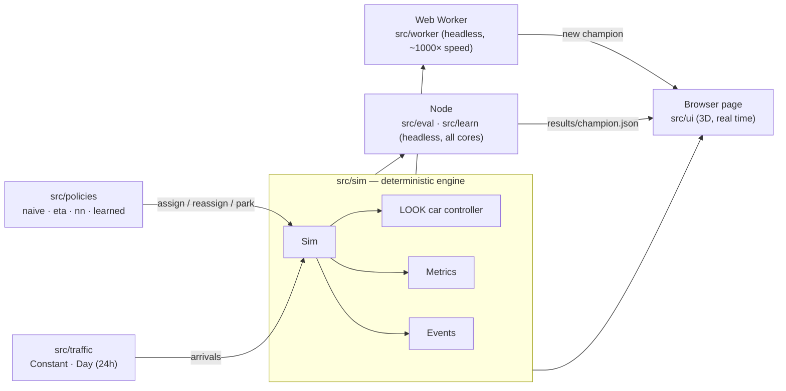

# Architecture & stack

## Stack

| Layer | Choice | Why |
|---|---|---|
| Language | **TypeScript** (strict) everywhere | One codebase for the page, the learning worker and the Node scripts. Types keep the engine ↔ policy ↔ UI contracts honest. |
| Build / dev server | **Vite** | Zero-config TS, Web Worker bundling (`new Worker(new URL(...))`), static output for GitHub Pages. |
| Tests | **Vitest** + **jsdom** | Fast unit tests. jsdom runs the *original* single-file page headlessly for the parity test. |
| Node scripts | **tsx** | Runs the TS training/eval CLIs directly. |
| Parallel training | Node **worker_threads** | Offline training evaluates candidates across all CPU cores. |
| 3D | **CSS 3D transforms** (`preserve-3d`) | No WebGL, no libraries — same look as the original prototype. |
| ML | **Plain TypeScript** | CMA-ES, evolution strategies and a tiny MLP are a few hundred lines; no TF.js or Python needed at this scale. |
| CI / hosting | **GitHub Actions** + **GitHub Pages** | Typecheck, tests and a reduced eval on every PR; static deploy on push to `main`. |

There are **no runtime dependencies**. Everything in `dependencies` is dev tooling.

### Why not Python?

A Python RL stack (Gymnasium + Stable-Baselines3) would mean a *second simulator* to keep in sync with the one people watch in the browser. Any drift between them makes trained results meaningless. The learning methods used here (black-box optimisation, neuroevolution) don't need Python's RL libraries, so the project stays TypeScript-only. Python remains an option for offline analysis of `results/*.json`, or for deep RL later through a bridge to the Node engine.

## One engine, three hosts



The page, the in-browser learner and the offline trainer all run **the same `Sim` class**. What you watch is exactly what was trained and measured.

## Module map

```
src/sim/        engine — no DOM, no Math.random
  sim.ts          Sim: fixed-step clock, car controller, call assignment, events
  eta.ts          committedStops, etaOf (ETA maths shared by policies)
  rng.ts          seeded sfc32 PRNG (+ poisson, normal, weighted)
  metrics.ts      waits / trips / served, mean, quantile
  types.ts        BuildingConfig, Car, HallCall, SimEvent, Regime
src/policies/   dispatch decisions
  naive.ts        nearest car
  eta.ts          parametric cost function (V0 = original constants), zoning, param vectors
  nn.ts           MLP residual on top of the heuristic
  learned.ts      champion → Policy
src/traffic/    demand
  traffic.ts      ConstantTraffic (live UI), DayTraffic (24-hour model)
  scenario.ts     benchmark grid, seed splits, domain randomisation, simFor()
src/eval/       measurement
  run.ts          runScenario, summarize, SCORE
  stats.ts        paired bootstrap, promotion gate
  suite.ts        policies × scenarios, aggregation
  report.ts       leaderboard JSON / Markdown / console tables
  cli.ts          npm run eval
src/learn/      training
  cmaes.ts        CMA-ES
  es.ts           OpenAI-style evolution strategies with Adam
  trainer.ts      per-regime heuristic trainer, gate helpers
  evaluate.ts     plain-data policy specs, batch evaluation
  pool.ts         worker_threads pool (Node only)
  cli.ts          npm run train
  cli-nn.ts       npm run train:nn
  champion.ts     the Champion file format
src/worker/     in-browser learning (protocol.ts = message contract)
src/ui/         the 3D app (scene, setup screen, learning card, EN/BG i18n)
scenarios/      suite.json — benchmark buildings, windows, seed ranges
results/        champion.json, nn-champion.json, leaderboard.*, training-log.json
legacy/v0.html  the original single-file prototype (parity baseline)
```

## Engine design

**Deterministic.** All randomness goes through one seeded `Rng`. A `(scenario, seed)` pair always produces the same run, on any machine. That makes training reproducible and comparisons *paired*.

**Fixed time step.** The clock advances in 0.1 s steps. `sim.advance(seconds)` accumulates real frame time for the UI. `sim.runUntil(t)` runs as fast as possible for training and evals: a 45-minute window takes 3–10 ms.

**Each step:**
1. Arrivals: Poisson draw with mean `rate(t) · dt` from the traffic source.
2. Every car steps: doors count down, moving cars advance, idle cars pick their next target.
3. Every *reassign interval*, the policy may move hall calls between cars.

**Separation of concerns.**
- The **car controller** (in `Sim`) decides *how* a car serves the stops it owns. It uses LOOK: keep direction while stops lie ahead, only pick up passengers going that way.
- The **policy** decides *which* car owns each hall call, when to reassign, and where idle cars park:

```ts
interface Policy {
  assign(sim, call): { car, cost }   // new hall call
  reassign?(sim): void               // periodic pass, calls sim.moveCall()
  reassignInterval?(sim): number     // seconds between passes
  parkTarget?(sim, car): level|null  // zoning
}
```

**Events, not DOM.** The engine emits `assign`, `reassign`, `pickup`, `dropoff`, `full` and `policy` events. The UI formats them into the bilingual log. Training ignores them.

## Fidelity to the original

`legacy/v0.html` is kept untouched. `test/parity.test.ts` loads it in jsdom, feeds it and the new engine **the same arrival trace**, and requires identical per-passenger wait and trip times (to 1e-6 s) for both ETA v0 and naive dispatch.

Extracting the engine exposed a freeze in the original. If a car stopped at a floor whose assigned call pointed the other way while riders were heading on, or the car was full, it re-opened its doors there forever. This hit about 26 % of benchmark runs. The engine fixes it, and a liveness test guards it. `legacyDoorFreeze: true` reproduces the old behaviour for the parity test only.
